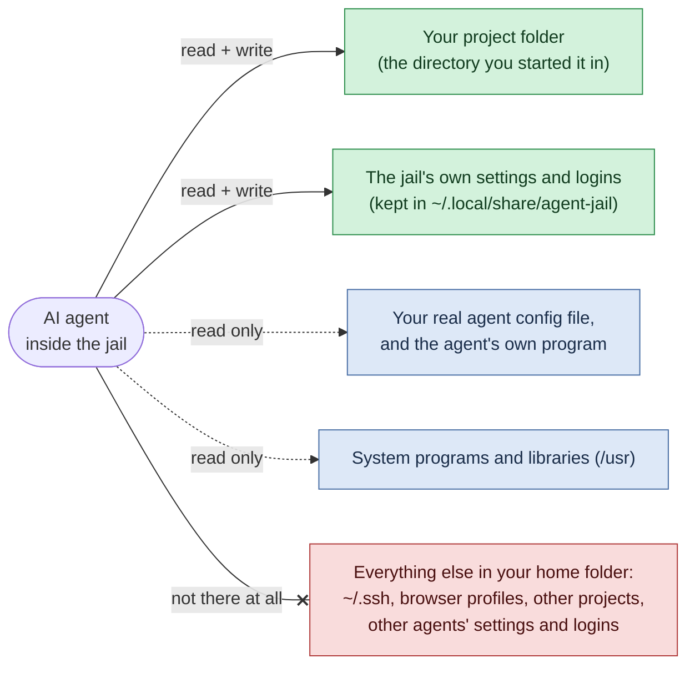
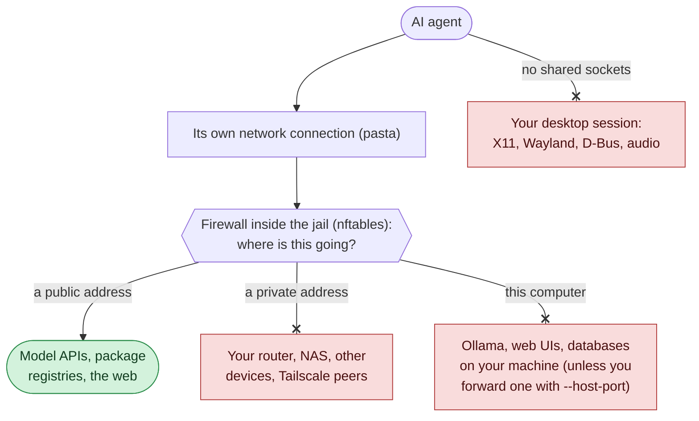
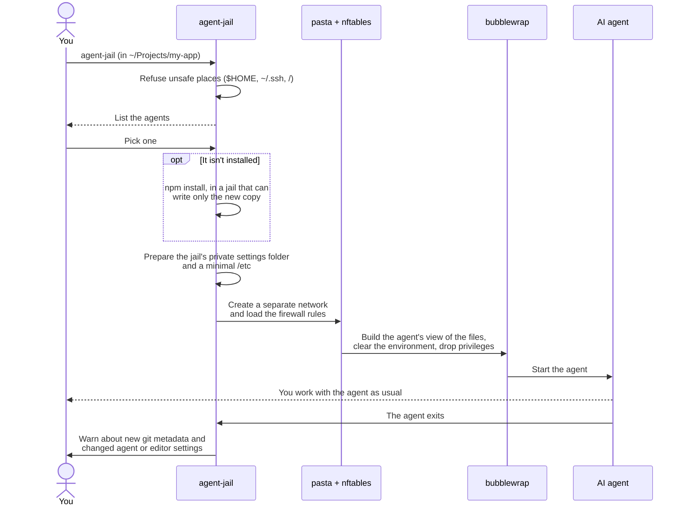
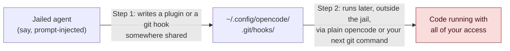

# agent-jail

[](https://github.com/jackbelmore/agent-jail/actions/workflows/ci.yml)

**Run Claude Code, Codex, Gemini CLI and other AI coding agents so that they can
change only the folder you start them in.**

<p align="center">
  
</p>

An agent's own permission prompts are checked by the agent itself, and
"yolo"/`--auto` modes switch them off. `agent-jail` puts the boundary in the Linux
kernel instead, so it holds whatever the model is talked into doing:

- **Your files stay out of reach.** The agent sees your project and its own
  settings. Your SSH keys, browser profiles and other projects aren't hidden
  behind a check; they aren't there at all.
- **Your network stays private.** It reaches model APIs and the public web, but
  not services on your machine, your LAN or your tailnet.
- **Nothing it leaves behind runs later.** Git hooks and config are read-only, its
  settings live in a private folder, and you're told when it changes files that
  other tools run commands from.
- **One command for every agent.** Pick one from a list. If it isn't installed,
  `agent-jail` installs it, with npm running inside a jail too.

## Quick start

```sh
git clone https://github.com/jackbelmore/agent-jail
install -m 755 agent-jail/bin/agent-jail ~/.local/bin/
cd ~/Projects/my-app
agent-jail
```

Choose with the arrow keys and Enter, or press a number. You need Linux with
[bubblewrap] 0.8 or newer, and for the default network mode `pasta` (package
`passt`) and `nft` (package `nftables`). The npm-packaged agents also need Node.js
and npm. See [Requirements](#requirements).

Or name the agent and skip the list:

```console
$ agent-jail codex                        # public internet only (the default)
$ agent-jail --host-port 11434 opencode   # plus a local Ollama on the host
$ agent-jail --net none qwen              # no network at all
$ agent-jail --shell codex                # a shell with the agent's exact view
$ agent-jail --install claude             # install or update an agent
```

## Supported agents

| Agent | Run | Installs | Logging in, inside the jail |
|---|---|---|---|
| Claude Code | `agent-jail claude` | `@anthropic-ai/claude-code` | `/login`, then open the link it prints and paste the code back |
| Codex | `agent-jail codex` | `@openai/codex` | `agent-jail codex login --device-auth`, or `printenv OPENAI_API_KEY \| agent-jail codex login --with-api-key` |
| Gemini CLI | `agent-jail gemini` | `@google/gemini-cli` | "Login with Google" prints a link and asks for the code, because the jail has no browser |
| Qwen Code | `agent-jail qwen` | `@qwen-code/qwen-code` | From inside `agent-jail qwen` |
| OpenCode | `agent-jail opencode` | `opencode-ai` | `agent-jail opencode auth login` |
| Continue | `agent-jail continue` | `@continuedev/cli` | Through `~/.continue/config.yaml`, which the jail reads but can't change |
| A shell | `agent-jail shell` | built in | Nothing to log in to: it's for seeing what an agent would see |

Each agent keeps its logins, sessions and settings in
`~/.local/share/agent-jail/<profile>/`, apart from its usual config, so log in once
inside the jail. API keys in your shell don't reach the agent (the environment is
cleared), and a login that waits for your browser to come back to `localhost`
can't finish, because the jail's localhost isn't your browser's. That's why the
table uses device-code and paste-the-code logins.

Per agent:

- **Codex: its own sandbox is off inside the jail.** Codex runs every command it
  makes in its own bubblewrap sandbox, which needs the user namespaces the jail
  disables, so each command would fail. The jail's copy of `config.toml` starts
  with `sandbox_mode = "danger-full-access"`: the jail is the sandbox. Codex still
  asks for approval as its approval policy says.
- **Claude Code**: all of its state, including `.claude.json`, is in the jail's
  `~/.claude`, and its auto-updater is off.
- **Gemini CLI and Qwen Code** start with usage statistics and auto-update off,
  and Qwen Code's telemetry host is blocked.
- **OpenCode** reads your `~/.config/opencode/opencode.json` but can't change it;
  auto-update and session sharing are off.

### Installing agents

When you pick an agent that isn't installed, or run `agent-jail --install NAME`,
`agent-jail` installs its npm package into `~/.local/share/agent-jail/tools/NAME/`
rather than your global npm folder. `npm install` runs in a jail of its own that
can write only the new copy, so a package's install scripts can't read your files
or plant anything outside it. The agent then runs from that copy, which it can't
modify. Running `--install` again updates it; if the update fails, the old copy
stays.

An agent installed this way is used before one on your `PATH`; otherwise
`agent-jail` runs the one on your `PATH`. `agent-jail --list` prints the list
without asking anything.

## How it works, in simple terms

Think of the jail as a room that is built for the agent each time you start it.

- **Only what the agent needs is in the room.** Your project folder, which it
  can change; a private folder for its own settings and logins, which it can
  change and which is kept between runs; and the system's programs, which it can
  only read. Your SSH keys, browser profiles and other projects aren't behind a
  permission check that a clever prompt could talk its way past. They simply
  aren't in the room.
- **The room has its own door to the internet, with a guard on it.** The agent
  can reach model APIs and the public web, but anything addressed to your own
  computer, your home network or your tailnet is turned away.
- **Nothing it leaves behind runs later outside the room.** The places where a
  file can make code run automatically later (git hooks, git config, the agent's
  own plugin folder) are read-only or private to the jail, and you're told if it
  creates new git metadata or changes the settings other tools run commands from.

Here is a real session in the jail's shell. `~/.ssh/id_ed25519` exists outside
the jail:

<p align="center">
  
</p>

Three standard Linux tools do the work; `agent-jail` is a bash script that sets
them up together.

| Tool | What it does here |
|---|---|
| [bubblewrap] | Builds the room: the agent's own view of the filesystem and process list, no privileges, a cleared environment |
| [pasta] | Gives the room its own network connection, separate from your computer's |
| nftables | The guard: a firewall inside the room that rejects private and local addresses |

### What the agent can see



### Where it can connect



The guard checks what *kind* of address a connection goes to; it is not a list
of approved sites. So the agent can still send anything it can read to any
public server. That and the other limits are listed in
[docs/THREAT_MODEL.md](docs/THREAT_MODEL.md).

### What happens when you run it



## What the agent gets

| | Inside the jail |
|---|---|
| Current directory | read/write |
| Agent's own config, sessions, cache | read/write, but in `~/.local/share/agent-jail/<profile>/`, **not** the agent's normal directories |
| Your real agent config file | read-only (you keep one config; the agent can't edit it) |
| The agent's program | read-only, whether it's on your `PATH` or installed by `agent-jail` |
| Rest of `$HOME` (`~/.ssh`, browser profiles, other projects, other agents) | invisible (`$HOME` is an empty tmpfs) |
| `/usr` | read-only |
| `/etc` | `passwd`, `group`, TLS roots, timezone and a generated `hosts`/`resolv.conf` only |
| `.git/hooks`, `.git/config` | read-only (commits still work; `--git ro` blocks those too) |
| Agent and editor settings in the project (`.claude/`, `.codex/`, `.mcp.json`, `.vscode/`, `.envrc`, ...) | read/write, but any change is reported after the run |
| Environment | cleared (API keys and tokens in your shell don't leak in) |
| `/run/user` (D-Bus, Wayland, PipeWire) | absent |
| Network (`--net isolated`, the default) | own network namespace via [pasta]; nftables rejects loopback, RFC 1918, CGNAT/Tailscale, link-local and multicast; public internet works |
| Processes | own PID namespace; can't create user namespaces; no capabilities |

After the agent exits, `agent-jail` warns about any **new** `.git` directory or
pointer file it created, because git runs hooks and `core.fsmonitor` commands from
those the next time you type `git status` on the host. It also warns when the
agent created or changed a project file that another tool runs commands from:
Claude Code hooks in `.claude/settings.json`, MCP servers in `.mcp.json` or
`.codex/config.toml`, VS Code tasks, `.envrc`. Opening the project with that tool
outside the jail would run them with all of your access.

What it does **not** protect against (exfiltration of what's in the directory, code
you later run, kernel bugs, resource exhaustion, DNS tunnelling) is listed in
[docs/THREAT_MODEL.md](docs/THREAT_MODEL.md).

## Why these particular defences

Each one closes a hole found in earlier versions of these scripts, which used
`bwrap --share-net` and bound the agent's real config directories.

The first two holes are the same trick. A sandbox only helps if nothing the agent
writes inside it gets run later outside it:



`agent-jail` breaks step 1: the shared places are either private to the jail or
read-only.

The four holes:

1. **Persistence through the agent's own config.** The jailed agent could write
   `~/.config/opencode/`, which the *unjailed* `opencode` also reads (including its
   `node_modules/` plugins). A prompt-injected session could plant a plugin that
   runs outside the jail next time. Fixed by giving each profile private state and
   importing the real config read-only.
2. **Persistence through git.** `.git/hooks/` and `.git/config` were writable.
   Fixed by binding them read-only, re-binding worktree pointer files read-only, and
   reporting new git metadata after the run.
3. **The X server.** With `--share-net`, the jail shares the host's network
   namespace, and abstract Unix sockets (such as Xwayland's `@/tmp/.X11-unix/X0`)
   belong to the network namespace, not the filesystem. On the machine this was
   written on, the X server accepts any process of the same user
   (`SI:localuser`), so a "jailed" process could open an X11 connection and, from
   there, read and inject input into X11 windows. Fixed by giving the jail its own
   network namespace.
4. **Localhost, the LAN and the tailnet.** `--share-net` also exposed every
   service on `127.0.0.1` (an unauthenticated Ollama API, web UIs). Moving to pasta
   alone was not enough: pasta opens outbound connections from the host on the
   jail's behalf, so the router's admin page and the host's own Tailscale address
   were still reachable. Fixed by an nftables egress filter applied inside the
   jail's namespace, and by turning off pasta's default automatic port forwarding
   in all four directions.

Every one of these has a regression test in [tests/test_jail.py](tests/test_jail.py)
that attempts the escape.

## Requirements

- Linux with unprivileged user namespaces and a merged `/usr`
- [bubblewrap] 0.8 or newer
- `pasta` (package `passt`) and `nft` (package `nftables`), for the default
  `--net isolated`
- Node.js and npm, to install and run the npm-packaged agents

```sh
sudo dnf install bubblewrap passt nftables npm          # Fedora
sudo apt install bubblewrap passt nftables nodejs npm   # Debian, Ubuntu
```

Ubuntu 24.04 restricts unprivileged user namespaces with AppArmor. If bubblewrap
fails there with a permission error, allow it, for example with
`sudo sysctl kernel.apparmor_restrict_unprivileged_userns=0` (which is what CI
does).

## Usage

```
agent-jail [options] [PROFILE [ARGS...]]

  (no PROFILE)               pick an agent from a list, installing it if needed
  --list                     list the agents and whether they are installed
  --install NAME             install or update an agent's npm package, in a jail
  --net isolated|none|host   network mode (default isolated; host is unsafe)
  --host-port PORT           expose 127.0.0.1:PORT from the host (repeatable)
  --git protect|ro|off       git protection (default protect)
  --ro PATH                  expose an extra path read-only
  --shell                    run bash with the profile's sandbox instead
  --force                    run in a directory that is normally refused
  --dry-run                  print the pasta/bwrap command line
```

Options go before the profile, and also apply to the picker: `agent-jail --net
none` lists the agents and runs the one you choose without a network. ARGS go to
the agent, so `agent-jail codex exec "fix the tests"` works as you'd expect.

It refuses to start in `$HOME` or any directory above it, in top-level and
mount-root directories, and inside `~/.ssh`, `~/.config`, `~/.local` and similar.
Set `AGENT_JAIL_HOME` to keep the jail's state somewhere other than
`~/.local/share/agent-jail`, for example a separate one for projects you don't
trust.

Adding an agent is a line in `AGENTS` and a short shell function: see
`profile_gemini` in [bin/agent-jail](bin/agent-jail).

## Tests

```sh
python3 -m venv .venv && .venv/bin/pip install -r requirements-dev.txt
.venv/bin/pytest -v
```

The tests run against a throwaway `$HOME`, start real sandboxes, and try each
escape: reading a canary SSH key, leaking an environment variable, writing a git
hook or `core.fsmonitor`, re-pointing a worktree's `.git` file, planting a plugin
in the agent's config, following a symlink planted at an import path, an npm
install script reading secrets or writing outside its new package, changing a
project's Claude Code hooks or MCP servers, reaching a host TCP service and a host
abstract socket, and connecting to private address ranges. Others drive the picker
on a real pseudo-terminal. CI runs them on Ubuntu 24.04 together with shellcheck,
ruff and gitleaks.

The terminal pictures in this README are drawn from real runs by
[docs/screenshot.py](docs/screenshot.py).

## How this was built

The original `cn-jail`, `qwen-jail` and `opencode-jail` scripts came out of Claude
Code sessions in September and October 2026. I set the requirement (third-party
agents may only ever read the directory I run them in, and cloud models always go
through the jail); Claude wrote the bubblewrap invocations, probed from inside what
was still visible, and found and blocked a telemetry endpoint in one agent's
package.

This repository merges and hardens them. In October 2026 I asked Claude (Opus, in
Claude Code) to review my scripts before publishing them. That review found holes
1 and 2 above. While redesigning the network side, Claude tested and found 3 and 4
on my own machine and proposed the pasta + nftables design. Claude wrote most of
the code and the tests; I decided what to fix and publish and reviewed the result.
Commits carry `Co-Authored-By` trailers.

Later that month I asked Claude to make it work with Codex and to list and install
agents for me. Claude added the picker, the jailed installer, the Claude Code, Codex
and Gemini CLI profiles and the check for changed agent settings, and found while
testing that Codex's own sandbox can't start inside the jail.

## Licence

MIT

[bubblewrap]: https://github.com/containers/bubblewrap
[pasta]: https://passt.top/
