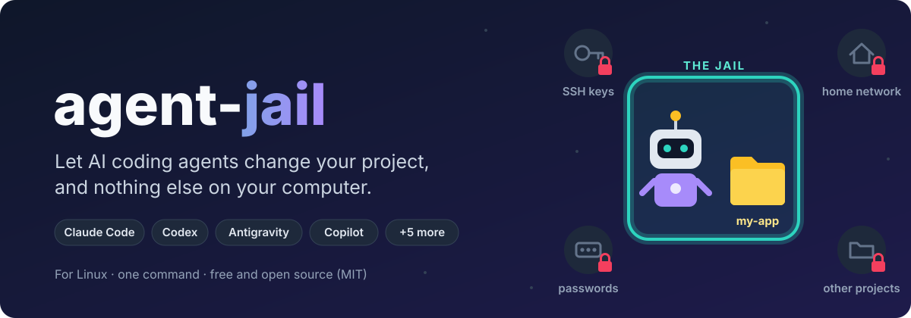
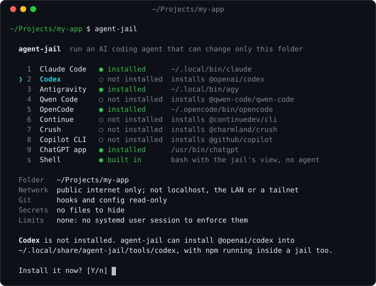

<p align="center">
  
</p>

<p align="center">
  <a href="https://github.com/jackbelmore/agent-jail/actions/workflows/ci.yml"></a>
  
  
  
</p>

**agent-jail** sandboxes AI coding agents on Linux so they can't touch your personal files, SSH keys, passwords, or local network. Inside the jail, an agent only sees the project folder you started it in, even if it gets prompt-injected or runs in "auto" or "yolo" mode.

## What it keeps out

- **Your personal files:** SSH keys, saved passwords, browser profiles, and other projects aren't in the jail at all.
- **Secrets in your project:** `.env` files, private keys, and similar files are hidden so the agent can't read them.
- **Your local network:** the agent can reach the public internet, but not your router, local devices, or apps running on your computer.
- **Traps for later:** git hooks, git config, and your real agent settings can't be changed, and you're warned if it edits project configs that run commands on your machine.
- **Shell keys & runaway processes:** API keys in your shell aren't passed in, and memory and process limits stop a runaway agent from freezing your PC.

## Quick start

Needs Linux plus `bubblewrap`, `passt`, `nftables`, and Node.js/npm (see [Ubuntu 24.04 & full requirements](docs/GUIDE.md#requirements) if anything fails):

```sh
sudo dnf install bubblewrap passt nftables npm          # Fedora
sudo apt install bubblewrap passt nftables nodejs npm   # Debian, Ubuntu
```

Clone, install, and run it in any project:

```sh
git clone https://github.com/jackbelmore/agent-jail
cd agent-jail && ./install.sh

cd ~/Projects/my-app
agent-jail
```

`./install.sh` checks your setup and flags anything missing (`git pull && ./install.sh` updates; `./install.sh --uninstall` removes it). Running `agent-jail` with no args opens the picker, and if an npm-based agent isn't installed yet, it installs it inside its own jail:

<p align="center">
  
</p>

## Supported agents

| Agent | Start it with | Log in the first time |
|---|---|---|
| Claude Code | `agent-jail claude` | Type `/login`, open the link, paste the code back |
| Codex | `agent-jail codex` | `agent-jail codex login --device-auth`, then enter the code shown on the web page |
| Antigravity CLI | `agent-jail agy` | Choose "Google OAuth", open the link, paste the code back. Install first with [Google's installer](https://antigravity.google/docs/getting-started?tab=cli) |
| Qwen Code | `agent-jail qwen` | Inside the app |
| OpenCode | `agent-jail opencode` | `agent-jail opencode auth login` |
| Continue | `agent-jail continue` | Uses your `~/.continue/config.yaml` (read-only) |
| Crush | `agent-jail crush` | `agent-jail crush login` |
| GitHub Copilot CLI | `agent-jail copilot` | `agent-jail copilot login --device-code` |
| ChatGPT desktop app | `agent-jail chatgpt` | In its own window; needs Wayland and OpenAI's app installed first ([notes](docs/GUIDE.md#supported-agents)) |

> [!NOTE]
> Agents log in **once, inside the jail** (`~/.local/share/agent-jail/<agent>/`), separate from your normal setup. Browser logins that redirect to `localhost` can't reach back into the jail, which is why the table uses device-code or paste-back flows. More per-agent details in [docs/GUIDE.md](docs/GUIDE.md#supported-agents).

## Handy options

```sh
agent-jail codex                                   # jump straight into Codex
agent-jail --net none claude                       # no internet at all
agent-jail --allow-host api.anthropic.com claude   # HTTPS to listed hosts only
agent-jail --host-port 11434 opencode              # let it talk to local Ollama
agent-jail --shell codex                           # poke around in bash (or `agent-jail shell`)
agent-jail --check                                 # check your setup
```

Drop default flags into `~/.config/agent-jail/config`. Projects can also have an `.agent-jail` file, which can only make the jail stricter. Full flag list in [docs/GUIDE.md](docs/GUIDE.md#usage).

## What it doesn't stop

- **Code the agent writes:** anything in the project runs with your full access when *you* run it later, so `git commit` before starting and check `git diff` first.
- **Uploading project files:** the agent can still send anything in the project folder out to the public internet unless you lock down egress with `--allow-host` or `--net none`.
- **Breaking the project folder:** it can delete or mess up files in the current directory, and an agent's jail state is shared across projects (set `AGENT_JAIL_HOME` for untrusted repos).
- **Kernel bugs:** this is a sandbox, not a VM, so it shares your Linux kernel. Check the full [threat model](docs/THREAT_MODEL.md) before trusting it with anything sensitive.

## Why not just...?

| | Agent's own settings | Docker container | Virtual machine | **agent-jail** |
|---|:-:|:-:|:-:|:-:|
| Keeps SSH keys, passwords & other projects out | ⚠️ varies | ✅ with careful mounts | ✅ | ✅ |
| Blocks your LAN & local services | ⚠️ on/off only | ❌ reachable by default | ⚠️ depends on setup | ✅ |
| Protects `.git/hooks` & `.git/config` | ⚠️ varies | ❌ `.git` is writable | ❌ if folder is shared | ✅ |
| Holds up under prompt injection / "auto" mode | ⚠️ partly | ✅ | ✅ | ✅ |
| Isolates Linux kernel bugs | ❌ | ❌ | ✅ | ❌ |
| Setup | Per-agent config | Image, mounts & logins | Full guest OS | One command |

See [docs/ALTERNATIVES.md](docs/ALTERNATIVES.md) for how it stacks up against Docker Sandboxes, Anthropic's `sandbox-runtime`, and `ai-jail`.

## Learn more

- [Full guide](docs/GUIDE.md): every flag, per-agent quirks, architecture diagrams, and how it was built with Claude Code
- [Threat model](docs/THREAT_MODEL.md): what's protected and what isn't
- [Alternatives](docs/ALTERNATIVES.md): how it compares to other AI agent sandboxes
- Deep dives: [seccomp filter](docs/SECCOMP.md) and [`--allow-host`](docs/ALLOW_HOST.md)

## Licence

MIT
